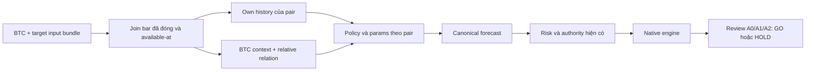

# Playbook E2E — từ nghiên cứu đến vận hành có kiểm chứng

Cập nhật: **27/10/2026, Asia/Ho_Chi_Minh**. Chủ sở hữu: operator/maintainer. Đây là kế hoạch giao việc, **không cấp quyền chạy campaign, kết nối sàn hoặc live**. Market vẫn PAUSED. User duyệt lập kế hoạch BTC context + policy riêng theo pair: xem §10. Phê duyệt lập kế hoạch chưa là implementation/data-read/market authority. [Memo](../RESEARCH_EVIDENCE.md) giữ lịch sử quyết định và limits.

## 1. Đích đến và phạm vi

Mục tiêu sản phẩm đầu tiên: một policy cho **một pair/timeframe** đã qualify, đi hết data → research → qualification → policy → runtime → vận hành được giám sát. Phạm vi nghiên cứu có thể có BTC làm context cho ETH/BNB theo §10; không bắt mọi pair dùng cùng params. Không thêm sàn, portfolio/short/funding engine, ML/router hoặc framework để thay cho bằng chứng còn thiếu.

Phải phân biệt ba mức hoàn thành:

| Mức | Khi nào được tuyên bố | Hiện tại |
| --- | --- | --- |
| E2E-MEASUREMENT-CLOSED | Input/source/config được bind; native execution, coverage và accounting được kiểm; có verdict kể cả ABSTAIN/INCOMPLETE | Đã có với RSI/ADX, MA baseline, hai pullback, volbreak và H-LIQ. Các verdict khác nhau, không có qualified winner. |
| E2E-PAPER-ACCEPTED | Một policy đủ điều kiện nghiên cứu được bind đúng runtime; parity và vận hành paper/testnet/shadow có evidence theo contract | Chưa đạt cho candidate hiện tại |
| LIVE-CANARY-ELIGIBLE | Research, release, vận hành và risk/account gates đủ trên exact subject; reviewer và operator chấp thuận | NO-GO; vẫn chưa phải quyền đặt lệnh hoặc tăng vốn |

Không thể hứa rằng lặp hữu hạn sẽ tìm được edge. **NO_SUPPORTED_WINNER / NO_TRADE là kết quả hợp lệ.** Nếu mục tiêu kinh tế không đạt, đóng hypothesis thay vì thay đổi tiêu chuẩn để gọi hoàn thành.

Luồng chính:

~~~text
E0: source/data/authority
  → E1: admission + preregistration + review
  → E2: một phép đo exploratory có ngân sách
  → E3: qualification/OOS/sensitivity + review
  → E4: policy binding + runtime parity
  → E5: paper/testnet/shadow + release evidence
  → E6: xét live canary → báo cáo canary → xét scale riêng

Engineering lỗi → loop sửa có giới hạn, giữ failed receipts
Thiếu data/sample → HOLD → đề xuất observation/design mới, không nới gate
Economics không đạt → đóng hypothesis → chỉ mở hypothesis mới khi được duyệt
Safety/identity/approval lỗi → BLOCK, không tự chuyển stage
~~~

## 2. Nguồn sự thật và trạng thái bắt đầu

Chỉ dùng **[CAMPAIGN_STATUS](../CAMPAIGN_STATUS.md)** để cập nhật tiến độ. File này định nghĩa cách làm; packet lưu evidence. Không tạo tracker/TODO mới cho từng agent hoặc sao chép metrics vào nhiều tài liệu.

Thứ tự xử lý mâu thuẫn: AGENTS.md và giới hạn quyền → executable contracts/policy được freeze → raw evidence trên đúng revision → tracker → kế hoạch → snapshot lịch sử. Nếu contract/code/document không khớp, dừng phần bị ảnh hưởng và ghi finding; không chọn nguồn dễ PASS hơn.

| Thành phần | Trạng thái có bằng chứng | Việc không được suy ra |
| --- | --- | --- |
| RSI/ADX BTC1h — local evidence `data/rsi_fixed_validation_run_20261024_01/RESULTS.md` | 3/3 cells; 39 trades/cost; ABSTAIN | Không có winner, không qualification |
| MA20/50 BTC1h — local evidence `data/ma_simple_baseline_validation_run_20261024_01/RESULTS.md` | 3/3 cells; 64 trades/cost; ABSTAIN; closed và open PnL được tách | Không rank trực tiếp với RSI vì khác window |
| MA registry sidecar — local evidence `data/ma_simple_baseline_validation_run_20261024_01/postrun_registry_review_20261025_01/RESULTS.md` | Read-only reconcile 3/3; original receipts giữ nguyên | Không chứng nhận DSR, không nâng economic verdict |
| BNB state-edge — local evidence `data/bnb_stateedge_economic_review_20261023_01/RESULTS.md` | 13/15 cells; INCOMPLETE/HOLD | Hai timeout vẫn UNKNOWN; không tự rerun để điền bảng |
| H-BRANCH-01 — local evidence `data/rsi_branch_attribution_20261024_01/RESULTS.md` | Đóng điều tra; không có căn cứ sửa owner-lock để cứu economics | Không chọn range-only từ subgroup hậu nghiệm |
| Pullback admission — local evidence `data/trend_pullback_admission_20261025_01/RESULTS.md` | 4/4 synthetic functions; có native trade thật; source không đổi | Không chứng minh samples/edge, không independent review |
| Pullback preregistration — local evidence `data/trend_pullback_prereg_20261025_01/RESULTS.md` | 1 fold/3 cells đã preflight; PREPARED_NOT_AUTHORIZED | Chưa có quyền market run từ tài liệu này |

Source8df9a071… và các hàng preparation bên trên là snapshot lịch sử của RSI/MA/pullback, không phải revision hiện tại hoặc pending authority. Trạng thái/revision hiện hành đọc ở tracker; H-LIQ giữ source đo a9133770… dù source sau đó đã được commit. Tests/config/payload có hash riêng; A phủ src/scripts không tự phủ tests. Dirty measured source không trở thành provenance-eligible chỉ vì commit về sau.

## 3. Vai trò, quyền và cách nhiều agent làm việc

| Vai trò | Trách nhiệm | Không tự làm |
| --- | --- | --- |
| Coordinator/integrator | Đọc tracker, chọn task đủ dependency, claim file/interface, gom revision, kiểm budget và bàn giao | Tự duyệt nghiên cứu/live hoặc gán self-review thành independent |
| Research owner | Hypothesis, params, exposure/trial history, data/fold/cost design và economic verdict | Chọn window/threshold theo outcome, xóa negative trials |
| Engineering/execution owner | Reproduce bug, patch nhỏ, native tests; chạy đúng một approved command | Đổi strategy/gates để sửa orchestration; tăng timeout/retry ngoài quyền |
| Evidence reviewer | Đọc raw material, source/assertions; kiểm độc lập arithmetic/negative cases/binding | Chỉ chạy lại script tác giả rồi gọi independent review |
| Ops/risk owner | Runtime mapping, account/environment boundaries, monitoring, recovery và release gates | Mở external session hoặc tăng risk/capital nếu chưa được duyệt |
| Human operator | Chọn scope, cấp ngân sách/quyền đọc/chạy; chấp thuận account/live/capital | Approval của agent không thay thế operator |

Một người có thể kiêm nhiều vai, nhưng author không tự đóng independent review. Reviewer có thể là agent khác tác giả với context/material phù hợp; phải công bố provenance và giới hạn, không giả danh bên thứ ba. **File này không cấp quyền tự spawn agent**: chỉ delegate khi user hoặc instruction áp dụng cho phép.

Quy tắc phối hợp:

1. Một writer cho mỗi file/interface. Claim owner + base revision + files ở task row hiện có; tránh sửa cùng source từ hai agent.
2. Không chỉnh src/scripts dùng chung khi campaign đang chạy; xác minh process thực tế, không tin registry stale. Không dừng process của user.
3. Local unit tests trên stores riêng có thể độc lập; AC01–AC15 phải serialize vì có shared producer paths. Market run hiện tại một worker, không chạy chồng campaign để tiết kiệm thời gian.
4. Sau integration: capture source/config/tests mới, chạy affected suites đúng revision; không cộng test counts giữa các SHAs thành PASS.
5. Chỉ review lại phần bị invalidate. Approval-only change không mặc nhiên cần full suite; phải chứng minh source/assertions không đổi và binding mới đúng. Code change không được dùng receipt cũ như receipt mới.

## 4. Work packages chi tiết

### E0 — Khóa điểm xuất phát, dữ liệu và authority

**Owner:** integrator + research owner. **Output:** một baseline record trong tracker, không một tracker mới.

- E0.1: đọc AGENTS.md, tracker Current, proposal và code consumer; kiểm tool/schema thật. Thiếu execute_shell_command: báo TOOL_UNAVAILABLE; không invent alias hoặc dùng shell. Fallback chỉ khi được cho phép cụ thể. Không suy quyền từ chat cũ về push/live.
- E0.2: kiểm actual PID/descendants, git status/diff và source/config/lockfile/assertion hashes. Phân loại user edits, task edits, unrelated edits; không reset, stash/clean hoặc commit/push tự ý. Không đưa secrets vào artifact.
- E0.3: giữ các failed/old packets. Nếu cần integration sạch cho qualification/release, đề xuất đúng diff/commit và xin quyền cần thiết; clean source mới không kế thừa qualification cũ chỉ vì tên strategy giống nhau.
- E0.4: lập data exposure record: physical file SHA riêng quality/metadata hash; timezone/open-close cutoff, rows, gaps, duplicate/NaN, prefix đọc/decoded/evaluated. UNKNOWN không được suy thành untouched. Timestamp preflight không là proof OHLCV quality hoặc historical non-exposure.
- E0.5: kiểm đủ eligible observations cho stage dự kiến. Current exposed 2023 input chỉ exploratory; confirmation cho mục tiêu 2026 cần design/observation scope riêng. Không tự download, mở reserved holdout hoặc sửa manifest để che mismatch.

**Exit:** source/config/input/authority nhất quán, mỗi UNKNOWN có owner và ảnh hưởng. Thay đổi sau freeze → dừng, ghi invalidation, tạo revision/packet mới nếu được duyệt. Không mua thêm audit khi không còn câu hỏi quyết định cụ thể.

### E1 — Admission và đóng băng một câu hỏi

**Owner:** research + execution; reviewer khác author cho official acceptance. **Output:** một proposal + frozen protocol + reviewer verdict.

- E1.1: đúng một strategy/pair/TF/parameter set, cơ chế có thể bác bỏ, lịch sử thử nghiệm và lý do chọn không phải max Sharpe. Phân biệt signal, filter, sizing và allocation.
- E1.2: đọc constructor/generate_signals, schema/default/registry, adapter và runner. Tên strategy không là proof semantics. Ví dụ pullback thực tế SMA20/80/ADX25/volume1.5, không EMA/Fibonacci/institutional flow; RSI period đang không tham gia signal nên không mở grid giả.
- E1.3: native synthetic positive và negative controls: có actual fills/trade, per-bar causality/timing, entry/exit, protection và inventory theo scope. Không gọi zero-trade identity là positive PASS. Ghi rõ injection so với actual indicators.
- E1.4: public preflight-only phải sinh đúng folds/cells/windows, không chỉ CLI chạy được. Pin params/cost bodies, history, source/config/environment, budget, trial burden, analytical comparisons và terminal outcomes.
- E1.5: reviewer kiểm source/assertions/raw receipts; ít nhất một positive/negative critical path khi scope/budget cho phép. Script của tác giả chỉ là self-verification. CHANGES_REQUIRED có severity, reproduction và file/interface ảnh hưởng; không lặp full review không thay đổi.
- E1.6: operator cấp authority riêng cho exact proposal/protocol/read scope/budget/output/environment. Fresh authorization record, không sửa proposal cũ để giả đã duyệt. Authority ≠ technical verdict; broad research CLI có thể chạy được không có nghĩa operator đã cho phép.

**Exit:** APPROVED_FOR_ONE_BOUNDED_RUN, hoặc BLOCKED_REVIEW / WAITING_OPERATOR. Đổi source, params, data/window, risk/cost, budget hay scope sau duyệt phải invalidate và review lại phần liên quan.

### E2 — Một phép đo exploratory, raw review và terminal verdict

**Owner:** execution → evidence reviewer → research owner. **Output:** packet mới đã seal + một quyết định.

1. Trước launch: kiểm actual competing processes; exact source/input/config/proposal hashes và output chưa dùng. Re-freeze qua launcher phải khớp prepared protocol; không copy protocol sang output khác mà bỏ kiểm binding.
2. Chạy existing launcher/supervisor/native engine bằng controlled_exec, .venv/bin/python, result file, heartbeat, timeout/RSS và one-worker/zero-retry đã duyệt. Không custom runner, monkeypatch hoặc bypass gate.
3. Cell đầu là official budget probe, tính một lần; stop-on-first technical failure. Không coi các cell NOT_ATTEMPTED là FAILED/completed hoặc tạo worker receipts giả.
4. Sau stop: kiểm process group/descendants thuộc run đã cleanup; giữ timeout/failed receipts. Không kill process không thuộc run.
5. Coverage: planned ↔ attempted ↔ completed/failed/unattempted; mỗi report SHA/source/params/cost/window khớp. Missing report không PASS. STARTED/no result/worker alive là RUNNING; worker chết là INTERRUPTED, không SELECT.
6. Accounting: fills/trade sum → closed gross-cost-net; closed net + open PnL → marked equity. Denominator là measurement opening equity. Không double-charge cost/inventory hoặc dùng gross_profit của winning trades như gross alpha.
7. Economics: samples, net expectancy/Sharpe/PF/DD, turnover/exposure, cost stress, concentration, reason/regime attribution với limits. Cash và passive benchmark phải cùng measurement window; khác native protection/authority phải công bố, không gọi risk-matched alpha.
8. Registry: nối evaluation key/attempt/report tới candidate ID, context, fold/phase/metric; query-only snapshot nếu cần. Ledger UNKNOWN lịch sử giữ nguyên, append sidecar thay vì sửa receipt đã seal.
9. Review mới phải phân biệt engineering/economic/qualification verdict; update tracker và đúng một next action. Không tự mở campaign khác.

| Trường hợp | Verdict | Được làm tiếp |
| --- | --- | --- |
| Drift/technical failure/timeout/coverage gap | INCOMPLETE_TECHNICAL | Điều tra read-only; fix loop khi còn đúng quyền/budget; không tự rerun market |
| Complete nhưng thiếu sample contract | INCOMPLETE_SAMPLE / ABSTAIN | Đề xuất observations/design mới; không hạ trade gate hoặc kéo dài window hậu nghiệm |
| Đủ mẫu, economics/selection không đạt | RESEARCH_ABSTAIN / NOT_QUALIFIED | Đóng hypothesis; hypothesis mới chỉ khi có lý do và authority mới |
| Selection đạt | DIAGNOSTIC_POSITIVE_NOT_QUALIFIED | Đề xuất E3; không publish/paper/live tự động |

### E3 — Qualification: chứng minh ngoài sample đã chọn

**Owner:** research + quant reviewer. **Dependencies:** candidate đáng nghiên cứu, clean/reviewed qualification revision và eligible data/methodology. **Output:** applicable gate report + independent verdict; không chỉ summary xanh.

- E3.1: trước khi đọc outcome, đóng folds/train/inner/outer/purge/embargo, overlap/dependence, selection/tie-break, costs, sensitivity, historical trials, gate applicability và toàn budget. Planner metadata chỉ chứng minh geometry, không power hoặc samples thực tế.
- E3.2: inner chọn params theo protocol; outer chỉ đánh giá lựa chọn trước đó, không dùng outer/holdout để chọn lại strategy/window. Exposed data không được relabel untouched.
- E3.3: historical selection burden gồm các khám phá ngoài registry; NO_MATCHING_HISTORY ở IDs mới không xóa thử nghiệm cũ. Khép câu hỏi DSR/PBO/dependence với reviewer trước claim, không chỉ điền số metric cho đủ schema.
- E3.4: sensitivity thực tế theo path qualification: cost2x, delay, neighbors và các arm applicable. Current neighbor implementation cần đủ giá trị axis và outer scope; không dùng synthetic hoặc validation-only thay real measured sensitivity. Fixed singleton parameter stability=1 không chứng minh robustness.
- E3.5: read/re-freeze current native gate contract; không đổi thresholds để candidate pass. Snapshot hiện tại có 20 gates, canonical_stats_verified và sensitivity_verified. Ví dụ: OOS Sharpe≥0.8, PF≥1.2, DD≤10%, Calmar≥0.5, DSR≥0.95, PBO≤0.2, ≥30 OOS trades; fold/cost/concentration/delay/neighbor gates cũng bắt buộc. Đây không phải toàn bộ gate set hoặc quyền áp chúng lên inner diagnostic.
- E3.6: holdout chỉ mở theo approval/protocol riêng sau design freeze; nếu đã expose hoặc thiếu eligibility thì không gọi là independent final test. Thiếu data/inference/sensitivity → BLOCKED_DATA_OR_METHOD, không waive/N/A để vượt gate.
- E3.7: reviewer kiểm raw continuous OOS equity, accounting, source/data/cost identity, full applicable gate results, trial burden và limits. Chỉ có QUALIFIED_RESEARCH khi toàn contract đạt trên exact subject; thiếu evidence là NOT_QUALIFIED.

Không có budget E3 mặc định từ 2100s exploratory. Tất cả folds/arms/probes/cleanup phải được đếm và duyệt trước; không bắt đầu khi budget hoặc một metric bắt buộc còn UNKNOWN.

### E4 — Đưa đúng qualified policy vào đúng runtime

**Owner:** execution + evidence/risk; đối chiếu L0/L1/L2 của [live readiness plan](LIVE_READINESS_AGENT_PLAN.md).

- E4.1: map actual entry point → resolver/artifact → strategy params/features/history → forecast → risk → target exposure → authority/planner → broker. Chứng minh đúng pair/TF/source/artifact/config/instrument rules, không silent fallback Enhanced MA.
- E4.2: hiện script live_enhanced_ma_binance.py còn bind enhanced_ma ở consumer được đọc. Pullback research PASS hypothetical không tự chạy được ở đó. Chỉ sửa wiring có scope sau qualification; không xây generic live platform trước khi có candidate.
- E4.3: replay cùng input/timestamps; freeze tolerances trước comparison. Kiểm vector tín hiệu và actual order/fill/mark/carry; khác sizing/stop/cooldown/cost/timing phải giải thích. Signal parity không bằng economic parity.
- E4.4: negative admission: missing/expired/wrong strategy/hash/environment/account/policy hoặc non-qualified evidence phải chặn BUY. Safe reduction giữ đúng policy; không khóa exits chỉ để no-order test PASS.
- E4.5: local fault drills: duplicate/partial/UNKNOWN fill, restart/cancel/stop races, missing protection, stale data, persistence/recovery. Isolated fixtures, không account calls hoặc fabricated live-eligible artifacts.

**Exit:** RUNTIME_PARITY_ACCEPTED trên integrated revision và qualified subject. Local plumbing có thể chuẩn bị sớm bằng non-promotable fixtures, nhưng không dùng để bỏ dependency research khi activate vận hành.

### E5 — Vận hành paper/testnet/shadow và release

**Owner:** ops/risk + execution + reviewer. **Dependencies:** exact admitted subject, environment/account approval, risk/loss budget/expiry, release và monitoring phù hợp. Xem [S7 runbook](../S7_OPERATIONAL_EVIDENCE_RUNBOOK.md), [production policy](../PRODUCTION_POLICY.md), live readiness L3.

- E5.1: tách environment/account stores, stable account identity, credentials scoped/withdrawal restrictions, symbol rules hiện hành, single leader/fencing và kill-switch owner. Không mở account/network session từ tài liệu này.
- E5.2: prove actual alerts đến observer, ledger/exchange reconciliation, exactly applicable protection, restart/network/UNKNOWN submit/cancel, backup/restore và rollback không replay submit. Dry-run không là proof drill thật.
- E5.3: policy-bound shadow và testnet evidence có đúng timestamps, unique lifecycle IDs, source/release/policy identity, healthy intervals, sample outcomes mature đúng lúc. Không gộp Alpaca paper/Binance testnet/Demo hoặc các subject khác nhau.
- E5.4: theo current contracts, testnet tối thiểu30 continuous days/100 unique complete lifecycles/0 unresolved orders/0 safety breaches; shadow tối thiểu30days/30observations/ECE≤0.10 và0critical alerts cùng các applicability rules. Recheck executable contract khi thực hiện; không lấy checkbox lịch sử làm acceptance hiện tại.
- E5.5: CI/release integrity: exact image/source/dependencies, signatures/SBOM/SLSA và verified artifact bindings theo release gate. Chưa truy cập/kiểm CI hoặc host thật thì NOT_VERIFIED; không push/deploy để tự chứng nhận.
- E5.6: integrate evidence review và permission expiry/rollback plan. Subject/release change phải đánh giá invalidation/reuse; không cộng ngày soak khác identity hoặc ép giao dịch chỉ để đủ count.

**Exit:** E2E-PAPER-ACCEPTED và release review đủ điều kiện, hoặc HOLD/NO_GO. Những elapsed-time gates cần wall-clock thật; không thể hoàn tất bằng một phiên test nhanh hoặc tạo timestamps giả.

### E6 — Live canary và xét scale riêng

**Owner:** human operator + risk/ops/reviewer. Đây là decision gate, không lệnh tự chạy.

E0–E5 đủ và approval ký đúng subject/account/release/pairs/risk-capital-loss budget/expiry/rollback owner → chỉ mới CANARY_ELIGIBLE. Actual canary cần permission riêng; deployment không auto-enable mainnet. Theo current S7, canary cần tối thiểu30days và0safety/loss-budget breaches trước scale review. Scale luôn là approval mới, không có cơ chế tự tăng vốn để bù lỗ.

Safety incident/unknown inventory/unresolved submit/failed protection/stale data/paging failure/drift/budget hoặc expiry → BLOCK new exposure, safe reduction theo quyền và escalate operator; không tự cancel protection hoặc đóng tài khoản ngoài runbook.

## 5. Vòng lặp có giới hạn — không chạy tới khi tình cờ có lãi

Các cap dưới là **đề xuất cho approval profile**, không tự cấp budget. Budget đã duyệt riêng có ưu tiên; không lấy ngân sách market bù engineering review.

| Loop | Cách làm | Giới hạn mặc định đề xuất | Điểm thoát |
| --- | --- | --- | --- |
| L-ENG | Evidence failure → reproduce → patch tối thiểu → affected tests → review → source/binding mới | Tối đa2 repair iterations; 180s/command và600s tổng local verification nếu được duyệt; test fail dừng để đọc receipt, không rerun command chưa sửa | Pass trên revision mới, hoặc UNVERIFIED/BLOCKED cần budget/scope mới; market run không auto retry |
| L-REVIEW | Findings có code/evidence → đóng finding → reviewer kiểm delta | Tối đa2 review rounds trong batch; không chạy cùng suite nguyên vẹn lặp lại chỉ để có thêm PASS | ACCEPTED trong scope hoặc NEEDS_DECISION với đúng blockers; không tự cấp independent label |
| L-MARKET | Một approved frozen candidate →3cells → raw review → terminal verdict | Current pullback proposal:600s/cell/2100s tổng,1worker,2048MiB sampledRSS,0retry; không automatic next hypothesis | Dừng sau một verdict, kể cả âm hoặc thiếu mẫu |
| L-HYPOTHESIS | Tổng hợp negative evidence → một thesis mới có cơ chế và quyết định cần trả lời → prereg | Không có quota tự động; nếu muốn autonomous batch, operator phải chốt trước số hypotheses/danh sách/rules/trial ledger và tổng budget; không dùng until-profitable | Có qualified research, hoặc hết approved search budget/eligible data → NO_SUPPORTED_WINNER |
| L-OPS | Observe authorized health → reconcile → mature outcomes → acceptance/incident review | Theo calendar, capital/loss/expiry của environment; không busy-wait hoặc tạo hoạt động giả | Accepted/HOLD/incident/expiry; không tự bật live hoặc tăng vốn |

Nếu chạm selection_policy.py, live_safety.py, nested_wfo.py hoặc evidence_ac*.py: **AC01–AC15 bắt buộc theo AGENTS.md**. Nếu cap600s không đủ affected tests+AC, dừng và xin điều chỉnh trước; không bỏ AC hoặc claim done. Tests cần .venv/bin/python và pytest -o addopts="". Không chạy full suite vô điều kiện sau thay đổi tài liệu/approval-only; chọn đúng surface, ghi skipped/NOT_RUN minh bạch.

Quy tắc chung mỗi iteration:

~~~text
READ tracker + exact task + authority + actual processes
IF dependency/identity/permission/budget thiếu: WAITING_INPUT, không thực thi
SELECT đúng một uncertainty và tiêu chí bác bỏ
DECLARE files/interfaces/output/cap/stop trước khi làm
EXECUTE trong scope bằng công cụ/schema thật, lưu receipt bền
VERIFY raw evidence + negative cases + identities; không chỉ đọc SUMMARY
IF technical failure: giữ receipts, phân loại trước mọi patch; chỉ loop nếu còn quyền/budget
IF economic/sample failure: đóng attempt; chỉ proposal mới, không tự rerun/tune
IF scope-pass: xin review/authority cho stage tiếp; không tự nhảy stage
UPDATE tracker: verdict + evidence + remaining budget + exactly one next action
~~~

Trước mỗi vòng, trả lời: kết quả mới có đổi quyết định nào không? Nếu không, không thêm lần seal/audit/test không cần thiết. Source change invalidate đúng dependencies; report/receipt/verdict content change là evidence change, không chỉ refresh bookkeeping. Proposal ≠ approval; self-verification ≠ independent review.

## 6. Các việc cụ thể ngay bây giờ

| ID | Đầu việc / owner | Trạng thái | Xong khi |
| --- | --- | --- | --- |
| NOW-01 | E2E playbook / integrator | Hoàn tất tài liệu ở lượt này | Một current plan, old history giữ nguyên, links hợp lệ; không campaign/production edit |
| NOW-02 | Pullback exact review / reviewer khác author | DONE26/10 | Separate-agent review accepted source d2864272… và protocol081fce81…; verdict trong execution packet, review cũ giữ nguyên |
| NOW-03 | Pullback one-run authority / operator | DONE26/10 | Authorization pin hashes cho đúng một packet3cells,read6160rows,measurement912,5232),600/2100s/1worker/2048MiB/0retry/failfast |
| NOW-04 | Execute/review current exploratory / execution + evidence | DONE26/10 | 3/3COMPLETED,coveragePASS,25trades/cost<30,ABSTAIN; independent post-runVERIFIED_INCOMPLETE_SAMPLE_ABSTAIN; registrySQLreconciliation vẫnUNKNOWN;không qualification |
| NEXT-01 | Spot research / research | PAUSED_AFTER_CLOSED_MEASUREMENTS 27/10 | H-LIQ-REVERSAL-01 rejects the fixed 1.5%/6 rule with native policy on [6510,15150) only. Gross was negative. Do not open another strategy from this closeout. |
| NEXT-02 | Measured liquidity-reversal source / maintainer | INTEGRATED_WITH_STATUS | The strategy patch is committed after the dirty-tree measurement. Packet source stays a9133770 and does not become qualified. |
| NEXT-DESK | Decision memo / research, documentation only | COMPLETE27/10 — PAUSED | Existing RESEARCH_EVIDENCE.md now separates measured failure, literature applicability and product-scope choices. No eligible new mechanism established in the sources reviewed. No candidate/run/data authority. Reopen only with the six admission questions answered and separate operator scope. |
| NEXT-DATA-DECISION | External-information feasibility / operator | DECLINED 27/10 — PAUSED | Metadata pilot stays NOT_AUTHORIZED. Trends is not an hourly BTC feed. GDELT cadence is undocumented as an edge, and 20 requests would not create a 2023 point-in-time cohort. No provider request, source change, or market run. |
| NEXT-03 | Qualification → runtime → ops / các owners | BLOCKED_BY_DEPENDENCIES | Đi tuần tự E3–E6, không tự tạo live authority |
| NEXT-CONTEXT-DESIGN | Shared validation, pair-specific policy / research | PLAN_COMPLETE27/10 — MARKET_PAUSED | One validation method. Pair signals and parameters may differ. BTC context and a past-only beta residual are allowed design inputs, not a strategy and not dominance. §10 defines X0–X6, A0/A1/A2 and identity/budget contracts. No data pull, router, implementation or campaign authority. |

H-PULLBACK-01 đóng INCOMPLETE_SAMPLE_ABSTAIN. H-PULLBACK-TEMPORAL-01 đóng VERIFIED_RESEARCH_ABSTAIN_NOT_QUALIFIED. H-VOLBREAK-01 đã đo xong và được review: VERIFIED_DIAGNOSTIC_POSITIVE_NOT_QUALIFIED. Đề xuất E3 ghi BLOCKED_DATA_OR_METHOD tại [E3 proposal — local evidence `data/volatility_breakout_e3_proposal_20261026_01/E3_PROPOSAL.md`. Không chạy cell qualification. Mainnet NO-GO.

## 7. Handoff, evidence và định nghĩa DONE

Mỗi task row ở tracker tối thiểu có:

~~~text
Task/stage; owner; reviewer/provenance; base và tested source/config/assertion identity
Question; non-goals; dependency/approval references; allowed files/interfaces
Input physical SHA/quality/UTC windows; read/decode/evaluation/exposure scopes
Planned/attempted/completed/failed/unattempted; attempts và trial accounting
Command/schema; per-command và aggregate cap; rc; wall/RSS; cleanup evidence
Raw paths/hashes; arithmetic and negative checks; changed/unchanged artifacts
Engineering verdict; economic verdict; qualification/operational authority verdict
UNKNOWN/NOT_RUN/blocked; remaining budget; exactly one next action và owner
~~~

DONE phải nghĩa là deliverable được kiểm trên đúng revision và scope, không phải “đã code” hoặc một dòng VERIFIED. Chính author có thể LOCAL_VERIFIED; independent acceptance cần người review khác với evidence thật. Kết quả âm vẫn là DONE cho task đo; không tự đổi thành OPEN để tiếp tục thử cho tới khi xanh.

Giữ packet cũ, failed receipts và negative trials. Không ghi đè immutable files; sidecar phải nêu mình bổ sung gì và hash/link bản gốc. Hash identity không chứng minh nội dung assertion đúng. Snapshot registry logic không phải full DB audit/DSR validation. Không ship evidence ra ngoài máy nếu chưa có quyền.

## 8. Điều gì thật sự đưa dự án gần sử dụng hơn

Đừng đo tiến độ bằng số strategy, số file hoặc số vòng review. Đo bằng:

1. Một câu hỏi được trả lời bằng native evidence đáng tin, kể cả NO_TRADE.
2. Một candidate vượt qualification trên observations đủ điều kiện, sau costs và uncertainty hợp lệ.
3. Exact qualified policy chạy đúng runtime, không fallback hoặc giảm protections.
4. Đủ lifecycle/reconciliation/alerts/recovery và elapsed-time gates của đúng environment.
5. Operator đủ thông tin để duyệt hoặc từ chối canary bằng risk/loss budget rõ ràng.

Hiện chúng ta đã có(1), chưa có(2)–(5) cho candidate sẵn sàng live. Không có ETA đảm bảo tìm được edge; thời gian operational soak không thể rút bằng compute. Giữ mainnet NO-GO đến khi toàn bộ contract và approval đạt.

## 9. Tài liệu liên quan và lịch sử

- [Tracker duy nhất](../CAMPAIGN_STATUS.md): trạng thái/evidence hiện hành.
- [Research run protocol](RESEARCH_RUN_PROTOCOL.md): checklist cho một phép đo, không là approval.
- [Live readiness L0–L4](LIVE_READINESS_AGENT_PLAN.md): task contracts chi tiết; handoffs lịch sử không là quyền hiện tại.
- [S7 evidence](../S7_OPERATIONAL_EVIDENCE_RUNBOOK.md), [production policy](../PRODUCTION_POLICY.md), [capability matrix](../CAPABILITY_MATRIX.md): acceptance/maturity, không bị playbook này waive.
- Pullback exact proposal — local evidence `data/trend_pullback_prereg_20261025_01/RESULTS.md`: source/protocol/input/budget cụ thể; không dùng số budget của BNB cũ hoặc candidate khác.
- [Bản kế hoạch trước E2E, archive nguyên bytes](archive/MULTI_STRATEGY_RESEARCH_PLAN_PRE_E2E_20261025.md): chỉ để truy vết; link tương đối bên trong snapshot có gốc cũ docs/operations, không là hướng dẫn execution hiện hành.

File này thay thế thứ tự công việc trong các snapshot cũ, không thay executable risk/research/release contracts, không đổi thresholds và không tự cấp bất kỳ external/live authority nào.

## 10. Kế hoạch BTC context và policy riêng theo pair

**Ngày27/10/2026: RESEARCH_DESIGN_COMPLETE / MARKET_PAUSED.** Thống nhất cách
kiểm chứng; cho phép policy/params khác theo pair khi có evidence. Không ép
một rule lên mọi coin, cũng không xây optimizer riêng cho từng coin. User mới
duyệt lập kế hoạch; không có candidate, data-read hoặc market budget mới.

### 10.1 Câu hỏi và phạm vi

Câu hỏi chính: BTC context và quan hệ tương đối có bổ sung giá trị quyết định
ngoài own history của ETH/BNB **sau costs và native execution** không? Câu hỏi
thứ hai: cá thể hóa params có tốt hơn shared params ngoài sample không?
Không mặc định mọi pair phải khác hoặc giống nhau.

Universe dự kiến: BTC/USDT làm context, ETH/USDT và BNB/USDT là hai target,
Binance Spot, long-only, USDT accounting. Chưa chứng nhận data eligibility
của hai target. Target thiếu data ⇒ HOLD target ấy, không tự thay coin.
Dùng nến1h trước; holding/forecast horizon là field riêng, chốt ở X2; chưa
nhân thêm4h/1d. BTC không là trading target trong batch này. V1 live vẫn chỉ
một qualified target, không mở portfolio từ việc có hai research targets.

Không thêm short/funding/perp, news/LLM collector, ML/router platform hoặc
17-strategy tournament. Các rule cũ giữ verdict đóng; không relabel một
retune thành cơ chế mới. External-news metadata pilot vẫn bị từ chối.

### 10.2 Input và feature contract tối thiểu

**Bind một bundle BTC+target:** path/byteSHA/exchange/symbol/timeframe của
tất cả inputs; quality/exposure/read-decode-evaluation scopes; timestamp
convention, join/missing-data policy, feature code/schema/config, source và
dependency identity. Bundle hash phải đi qua protocol/cache/trial context/
worker/raw report. BTC đổi ⇒ invalidate cả hai target dùng BTC; ETH đổi ⇒
invalidate study ETH. Không reuse chỉ vì target file không đổi.

Inventory26/10 — local evidence `data/confirmation_design_20261026_01/RESULTS.md` chỉ
ghi hash/metadata/timestamps; không chứng nhận quality/exposure ETH/BNB. Nó
còn ghi mismatch và reserved rows trong raw containers. Không decode whole
raw rồi filter để vượt quyền đọc; nếu không có bounded eligible artifact
thì BLOCKED_DATA. Không download/sửa manifest/mở holdout từ kế hoạch này.
Giá chưa được chứng minh untouched giữ UNKNOWN; không relabel confirmation.

UTC, bar-open/bar-close và available-at phải rõ. BTC/target chỉ join trên
bar đã đóng; không backward-fill, không dùng BTC tương lai, không inner-join
lặng lẽ xóa đoạn xấu. Gap/stale context ⇒ block new entry; protection và
exit/reduce an toàn vẫn theo authority. V1 không forward-fill OHLCV qua gap.

Feature draft **6 values** dưới đây là baseline khởi đầu, **không giới hạn
danh mục nghiên cứu**. Theo steering mới27/10, lập danh mục rộng và kiểm giá
trị thông tin theo §10.8 trước khi chọn feature cho policy. Lookback24/168
là seed để review, chưa có evidence edge; không mở grid ngầm:

| Nhóm | Draft | Câu hỏi |
| --- | --- | --- |
| C1 BTC context | Log return1bar, return24bar, realized volatility24bar | Bối cảnh hướng/biến động BTC có giúp quyết định target? |
| C2 Relation | Beta và correlation target–BTC trên168returns **trước current return** | Mức nhạy thị trường và sự ổn định quan hệ? |
| C2 Relation | Tổng24bar residual `r_target[s] − beta[s−1]×r_BTC[s]` | Target mạnh/yếu hơn phần BTC giải thích? |

Beta OLS trên returns, không regression mù price levels. Mỗi beta[s−1] chỉ
dùng dữ liệu tới s−1; varianceBTC gần0/gap/thiếu history/nonfinite ⇒ feature
unavailable, không fill0. Epsilon, min-history và estimator convention chốt
ở X1. Mọi thresholds/scalers học trong train, freeze theo fold; rolling
feature không là quyền online retune. Relative strength dương không bảo đảm
returnUSDT dương; ratio lệch không mặc định mean-revert/cointegrate.
ETH/BTC hoặc BNB/BTC tính từ closesUSDT không là cross-pair executable fills.

DOM tạm hiểu **BTC dominance**; nếu là Depth of Market thì phải làm rõ
trước code vì cần order-book contract khác. BTC.D thật cần market caps,
universe/stablecoin treatment/vintage/available-at nhất quán; không giả từ
tổng3prices/volumes. Nếu chưa có eligible history thì DOM **DEFERRED**. V1
không phụ thuộc DOM, không proxy giả; thêm nó sau là C3/attempt/budget riêng,
không thêm sau khi nhìn A2. Market cap/dominance không là cash flow trực tiếp.

### 10.3 Các phase, owner và điều kiện dừng

| Phase | Owner / công việc | Deliverable | Exit hoặc stop |
| --- | --- | --- | --- |
| X0 Data admission | Data owner đối chiếu BTC/ETH/BNB và catalog nguồn ứng viên §10.8; không tự mở provider | Bundle draft + information/source inventory + gaps/exposure/read-scope request | Mỗi nhóm có ADMITTED/NOT_ADMITTED/UNKNOWN; thiếu một nhóm không tự bị gán neutral; chưa strategy |
| X1 Feature contract | Engineer + research chốt formulas/availability/roles/identity cho nhóm được admit, synthetic trước | Versioned catalog + reference values + evidence-table schema | Point-in-time/gap/identity tests đạt; chỉ đúng nhóm được phép, chưa market |
| X2 Pair policy preregistration | X2a preregister phép kiểm giá trị thông tin theo nhóm; X2b chỉ chọn policy/configs sau discovery có evidence | Feature/group/interaction trial ledger, nested time design; sau đó entry/exit/horizon/params/budget riêng | Information selection chỉ trong train/inner; confirmation/outer không được dùng chọn feature. Independent design review; chưa run |
| X3 Integration | Engineer nối bundle/context qua đường validation hiện có | Minimal patch + full-launcher synthetic + pinned assertions/source | Positive/negative chain đạt, no dropped context hop; gate-file changes có AC01–15 |
| X4 Exploratory batch | Execution theo exact operator authority,1worker/0retry | Planned/attempted/completed, raw reports, paired comparisons, independent verdict | COMPLETE_DIAGNOSTIC/INCOMPLETE/HOLD; không tự thêm pair/feature/window/retry |
| X5 Confirmation | Quant reviewer khóa cohort/method trước outer | Applicable research gates trên exact selected subject | QUALIFIED_RESEARCH hoặc NOT_QUALIFIED; exposed data không confirmation |
| X6 Runtime và ops | Ops nối đúng một qualified target/context feed, chứng minh parity | E4–E6 evidence, account/risk approval, canary proposal | Theo gates hiện hành; live permission riêng |

X2 không DONE chỉ vì có feature list. Phải nêu nguồn payoff, dự đoán hướng
nào, khi nào không mua, absoluteUSDT net objective, timing và lý do params
từng pair **trước kết quả**. Không tự chọn ML/forecast regression hoặc đưa
stateful estimator vào legacy adapter; fold-local fitting cần support review
riêng. Rolling beta ở X1 là feature, không tự thành fitted alpha model.

### 10.4 Đối chứng A0/A1/A2 và params theo pair

- **A0:** pair-only control dùng own history.
- **A1:** A0 + BTC context C1.
- **A2:** A1 + relation C2.

X2 định nghĩa explicit remove/neutralize feature mà A0 vẫn là valid baseline,
không zero-trade fixture vì bỏ mất chính trigger. Cùng cấu trúc policy,
cadence/entry-exit, native safety, capital và search budget; không cho A2 thêm
params/trials ngoài protocol. Nếu train-fit per arm thì cùng recipe/budget
và phải tính search burden. Không mở lại tuning closedBTC rule để làm control.

So A1−A0/A2−A1 trên **cùng pair, UTC calendar, cost, policy và input bundle**.
Bộ timestamp đủ điều kiện cho so sánh phải chốt chung trước khi đo; report
mọi missing/stale mask, không cho A1/A2 hưởng lợi chỉ vì bị loại đoạn giá mà
A0 còn giao dịch. Giữ toàn calendar trong accounting; không xóa gaps khỏi
equity rồi tính Sharpe như thời gian liên tục.
Báo net marked return/PnL, Sharpe/PF/DD, trades, turnover/cost/exposure, tail
loss, authority skips; đọc signal/fill/stop/breaker path để giải thích. Không
gọi pure feature alpha khi sizing/path đổi. Không drop cost âm/pool hai coin
thành independent samples. Gaps, calendar overlap và return dependence được
chốt trong inference design. Không dùng một trận bullmarket để chọn regime.

Muốn claim params riêng tốt hơn thì cần preregister **shared-param vs
pair-specific-param** contrast với cùng family/training budget/cost. Nó thêm
trials/cells; không nhét vào18cell core sau outcome. V1 có thể dùng fixed pair
configs có lý do và ghi **chưa chứng minh personalization tốt hơn**. ETH pass,
BNB fail thì đóng đúng BNB, không hạ gate để đủ bảng hai target.

### 10.5 Budget, statistics và verdict

Core2targets×3arms×3costs×Ffolds,1fixed config/target = **18F evaluations**.
Nếu grid có M_ETH/M_BNB configs: `9F×(M_ETH+M_BNB)` inner evaluations,
chưa tính param contrast, outer, sensitivity/probes. Feature/window/model
alternatives cũng là search; ba cost và hai coin cùng BTC không independent.

Không kế thừa600/2100s của H-LIQ. Public plan-only đếm exact cells trước;
wall envelope gồm cell bounds + orchestration/cleanup, RSS và per-command
caps.18cells×600s =10800s trước overhead, không nhét vào2100s. Synthetic
representative probe đo engineering cost; market first cell chỉ là official
probe nếu được duyệt, tính một lần. Stagewise schedule/stop rule phải freeze
trước outcome, không dừng control rồi hoàn tất riêng arm đang dương.

Native selection/qualification gates không đổi. X2 phải khóa incremental
context acceptance: primary endpoint, minimum economically meaningful gain,
uncertainty/dependence method, risk non-inferiority và cost robustness. Không
invent cutoff sau Sharpe. Thiếu sample/method ⇒ INCONCLUSIVE; A2 dương nhưng
không hơn A0 không chứng minh context edge; hơn A0 mà net âm chưa đủ để đầu
tư confirmation. Inner SELECT không là qualification.

DSR/PBO phải xét attempts cũ/mới, pair/arm/feature/model/params; SQL không tự
bao hết search history. PBO cần candidate/loss matrix hợp lệ; không grid giả
hoặc waive singleton. Method/cohort thiếu ⇒ BLOCKED_DATA_OR_METHOD ở X5.

### 10.6 Điểm nối code và kiểm chứng bắt buộc

Impact map, chưa là instruction sửa toàn bộ:

| Interface | Hiện trạng đã đọc | X1/X3 phải chứng minh |
| --- | --- | --- |
| `research/forecast.py:MarketObservation.features` | Có feature container, chưa tự chứng minh lineage/as-of | Schema/version/availability/context hash |
| `strategies/canonical/adapter.py` | Legacy adapter đọc một ohlcv_window | Consumer thật sự đọc closed context, không chỉ thêm cột |
| `backtest/tournament.py:canonical_signal_series` | Window kết thúc trước j, simulator execute open j+1 | BTC/target cùng cutoff; không đọc current-row close j như closed input; giữ k+2 hoặc identity mới nếu đổi |
| `scripts/run_wfo_parallel.py` và worker | Bound protocol/cell/cache/request/report | Verify multi-input ở planner và worker, không hidden global reads |
| `backtest/nested_wfo.py` | Existing fold/gate/trial provenance | Purge/embargo theo max history/horizon, pair/arm identity; chạm file phải AC01–15 |
| Engine/authority/live consumer | Native protections; live còn EnhancedMA-specific | Không bypass; runtime wiring sau qualification; BTC feed thiếu không vô hiệu protection |

Synthetic phải có: mutate BTC tương lai không đổi quá khứ; barBTC j chưa
đóng không ảnh hưởng decisionj; missing/stale/gap chặn entry nhưng giữ exit/
protection; zero variance; beta/residual tính tay; full-vs-window parity hoặc
state contract rõ; đổi BTC bytes/cache miss; wrong target/arm/bundle reject;
actual native fills/stop/terminal inventory; **full launcher chain** một
positive và negative case trên isolated stores. Unit từng mảnh không thay
integration. Không profile market trước admission synthetic.

Hai nghiên cứu single-pair không chứng minh portfolio. ETH+BNB cùng lúc cần
shared-capital/correlated-exposure authority evidence; chưa có thì live chỉ
một qualified target. Không cộng hai25% exposures rồi gọi diversified;
không tự thêm beta hedge/short hoặc giảm protections.

### 10.7 Giao việc và bước kế tiếp

Một tracker CAMPAIGN_STATUS; X0…X6 là IDs của work packages trong kế hoạch,
không tạo thêm TODO/tracker. Handoff theo §7: identities, question/scope,
budget/commands, raw receipts, uncertainty/verdict và một next action.
Một writer/interface; reviewer khác author công bố independence và kiểm gì
ngoài chạy author script. Có thể giao agent riêng sau khi được user cho phép;
tài liệu không tự spawn/delegate hoặc cho nhiều writer sửa chung source.

**X0 đã có kết quả 27/10.** Hai file ETH/BNB 1h pre-holdout khớp toàn bộ
25198 timestamp của BTC frozen và đều qua `assess_ohlcv` `gap_policy=reject`.
Trạng thái QUALITY_ACCEPTED_DEVELOPMENT_INPUT_NOT_CONFIRMATION: input
development, không phải confirmation. Kết quả:
X0 — local evidence `data/x0_context_admission_20261027_01/RESULTS.md`. Raw 1h vẫn
bị loại vì chứa reserved rows. Không mở implementation, data download, DOM
collection hay market batch từ kết quả này. X1 contract `x1-20261027-01`
nằm ở `src/trading_agent/research/btc_context_features.py`; 11 synthetic
tests passed trước khi nối strategy. X2 đã khóa đối chứng A0/A1/A2 và luật
`H-OWN24-CONTEXT-01`. Phiên diagnostic 27/10 dừng INCOMPLETE_TECHNICAL ở
cell ETH A0 1x vì hết 600 giây, 0 cell hoàn tất; không nâng trần và không
chạy lại. Kết quả:
X2 run — local evidence `data/x2_context_run_20261027_01/RESULTS.md`.
X3 review đạt và exact operator authorization mới tới X4.
NO_INCREMENTAL_CONTEXT_VALUE và NO_SUPPORTED_WINNER vẫn là kết quả hợp lệ;
không tự thêm coin khi thất bại.

Cơ sở: [Cross-cryptocurrency return predictability](https://www.sciencedirect.com/science/article/abs/pii/S0165188924000551)
nghiên cứu minute-level, không chứng minh net alpha ở1h/k+2 của repo.
[CoinGecko market-cap definitions](https://www.coingecko.com/learn/what-is-market-cap-in-crypto)
phân biệt dominance với cash inflow. Primary preview/provider docs đã đọc,
không replicate hoặc dùng kết luận paper làm gatePASS.

### 10.8 Nghiên cứu nhiều thông tin để tìm phần thực sự có ích

Phiên thảo luận nhiều agent dùng [brief chung](ALTCOIN_INFORMATION_RESEARCH_DISCUSSION.md):
vai trò, câu hỏi D1–D8, mẫu contribution, phản biện và điều kiện bàn giao.
Brief không thay kế hoạch này hoặc cấp quyền chạy nghiên cứu.

**Steering27/10:** danh mục thông tin rộng, policy cuối chỉ giữ phần có bằng
chứng. Không loại trước một biến chỉ để giữ con số6; cũng không coi càng nhiều
cột thì càng có edge. Phân biệt candidate feature pool, admitted dataset và
selected policy inputs. Các nhóm dưới là **ứng viên có giả thuyết liên quan**,
chưa được xác nhận là nguyên nhân trực tiếp hoặc có predictive value.

| ID / nhóm | Thông tin ứng viên | Vai trò và điều cần phân biệt | Admission hiện tại |
| --- | --- | --- | --- |
| G0 Own-pair | Returns nhiều horizon, volatility/drawdown, volume surprise, candle/range structure | Thông tin riêng hay chỉ cùng một trend được biến đổi? | Chưa xác minh eligible ETH/BNB; không mặc định mọi window đã có quyền đọc |
| G1 BTC | Return/hướng, volatility, drawdown, shock và trạng thái volume | Market context/lead–lag hay phản ứng đồng thời đã nằm trong giá target? | Dùng đúng BTC artifact được bind, không tái dùng approval cũ |
| G2 ETH/benchmark | ETH context cho BNB, BTC-versus-ETH relative strength | ETH có bổ sung sau BTC không; khác loading không tự là forecast | Chỉ dùng historical closed context; không future target leakage |
| G3 Cross-asset relation | Lagged beta/correlation, residual, ratio, relative momentum/dispersion | Predict absolute USDT hay chỉ relative ranking; continuation hay reversal phải đặt trước | Pair/time alignment contract còn phải hoàn tất |
| G4 Market breadth | Advance/decline, share above fixed trend, return/volume dispersion | Basket strength khác betaBTC? Universe point-in-time và survivorship có đúng không? | BTC/ETH/BNB chỉ là breadth của3asset, không gọi toàn thị trường |
| G5 Liquidity/order flow | Spread, depth/imbalance, taker buy/sell, trade counts, impact proxies | Entry edge hay execution-cost/feasibility variable? | OHLCV không tái tạo true depth/spread; data mới NOT_ADMITTED |
| G6 Derivatives positioning | Funding, open interest và changes, basis, liquidation reports | Crowding/leverage context hay phản ứng sau giá? Provider/exchange coverage thế nào? | Chỉ là information-candidate; không mở perp/short. Không có quyền collection mới |
| G7 Dominance/capital structure | BTC.D, ETH.D, stablecoin supply/share, market cap | Market composition khác actual inflow; universe/supply revision có được giữ không? | DOM vẫn DEFERRED nếu chưa có eligible vintage; không proxy giả từ3OHLCV |
| G8 Coin-specific events | Unlock schedule, listings/delistings, network outage/upgrade, governance | Thông tin đã announce lúc nào, forecast hay realized event? | Cần first-known/versioned announcements; không dùng lịch đã sửa để backdate |
| G9 On-chain/flows | Exchange-flow estimates, address activity, concentration, BTC/ETH ETF-flow releases nếu phù hợp | Transfer/internal move khác trade/inflow; attribution và report lag ra sao? | Sources/timestamps/coverage chưa admit, không có quyền tải |
| G10 Macro/calendar | USD/rates/equity context, scheduled releases, actual/expected surprises, trading-session calendar | Có thêm thông tin ngoài crypto factor không; holiday/session/timezone và revision? | Expected phải là vintage trước release; actual/revised không backfill |
| G11 News/attention | Volume tin/attention, event categories, sentiment nếu có nguồn đáng tin | Tin dẫn giá hay chỉ tường thuật giá đã chạy? Duplicate/entity/model bias? | Metadata pilot đã DECLINED; catalog hóa không mở lại collector/LLM |

Không lấy toàn bộ nguồn mới ngay. X0 phân loại: (A) có thể tính từ dataset đã
được admit; (B) có field/archive nhưng chưa chứng minh PIT/quality; (C) cần
nguồn mới. B/C vẫn có trong danh mục, nhưng NOT_ADMITTED không thể xuất hiện
như feature0 trong market experiment. Thứ tự làm dựa trên khả năng trả lời
câu hỏi, availability/quality và chi phí, không dựa trên Sharpe đã xem.
Không mua API, tải dữ liệu hoặc sửa profile giao dịch từ việc liệt kê G6–G11.

**Mỗi feature phải có một hồ sơ đủ tái lập:** ID/group; driver/proxy/
consequence/execution/risk role; mechanism và competing explanation;
source/raw hash/entity/universe; event/published/first-seen/ingested/available
timestamps và revisions; formula/units/lag/lookback/horizon; stale/missing
policy; target/pair; correlation group; owner; permitted read/evaluation
scope; compute/data cost; trial/dependency identity. Nếu chưa biết thì ghi
UNKNOWN. Không để tên “dòng tiền”, “sentiment”, “smart money” thay definition.

#### Kiểm chứng theo funnel, không đưa mọi biến vào một optimizer

1. **Admission và timing trước payoff.** Kiểm PIT/quality/entity/source và
   causal alignment bằng metadata/synthetic trước. Loại leakage, invalid hoặc
   duplicate engineering features; không kết luận chúng không có kinh tế.
   Một bộ dữ liệu lấy hôm nay không tự phục hồi historical available-at.
2. **Chốt mục tiêu.** Forecast label là absolute futureUSDT return/risk hoặc
   execution cost theo horizon/timing được freeze; residual/relative return
   là target phụ nếu cần. Tách raw return predictability khỏi policy PnL.
   Với k+2, label không được giả mua ở closek. Các label overlap phải purge/
   embargo và mature trước fit; own/BTC/ETH data đều theo cùng time split.
3. **Discovery trong train/inner.** Bounded simple reference model hoặc
   deterministic tests được chốt trước; scalers, correlation clustering,
   lag/horizon choices, feature selection và interaction search đều fold-local.
   Không fit chọn toàn sample rồi mới WFO; không random split các hourly rows.
   Chưa thêm model class vào legacy path trước khi kiểm fold-local fit support.
4. **Kiểm theo nhóm và giá trị bổ sung.** A0/A1/A2 vẫn là baseline bắt đầu.
   Các nhóm được admit khác có add-group và drop-group contrasts với reference
   đã freeze. Ghi cả marginal và conditional incremental value. Hai biến
   thay thế nhau có thể có importance riêng thấp mà nhóm vẫn hữu ích.
5. **Interactions có giả thuyết.** Ví dụ BTC stress × relative strength hoặc
   OI change × price move chỉ là candidate interactions; phải preregister
   trước outcome và đếm trials. Không duyệt mọi tổ hợp `2^G` hoặc mọi lag.
   Univariate yếu không đủ loại tương tác đã đăng ký; không đổi pair/horizon
   tới khi một interaction dương.
6. **Importance có kiểm soát.** Ưu tiên held-out group ablation, stability
   across development folds và conditional/group tests. Nếu dùng permutation,
   cần block/time-preserving design thích hợp, không xáo ngẫu nhiên từng row
   rồi coi là mẫu thị trường hợp lệ. Correlated features và realistic-support
   violations phải được công bố. SHAP/tree importance chỉ hỗ trợ giải thích
   model, không chứng minh nhân quả hoặc khả năng trả phí.
7. **Economic test dưới native policy.** Chỉ nhóm/tập đã được chọn trong
   discovery mới vào một protocol mới có authority: cùng calendar/masks,
   costs/risks, actual signals→fills→PnL, turnover/exposure/tail loss/skip path.
   Cải thiện forecast score hoặc giảm lỗ chưa đủ để claim tradable edge.
8. **Confirmation khóa riêng.** Outer/cohort đủ điều kiện chỉ dùng xác nhận
   pipeline đã freeze, không làm feature-selection feedback. Nếu đọc outer
   rồi chọn lại nhóm thì nó đã thành development exposure và cần cohort mới.
   Không mở reserved holdout. Uncertainty/multiple-testing/dependence design
   và minimum economic improvement phải chốt trước; absence-of-evidence giữ
   INCONCLUSIVE khi power/sample thiếu.

Các contrasts bổ sung tăng sốcells/trials:18F trong §10.5 **chỉ còn là core
baseline**, không là budget toàn broad study. Catalog không tự tạo market
trial nhưng mọi price-return scan/feature screen đã thực thi đều ghi trong
research ledger, kể cả không register SQL. Selection của groups, interactions,
pair/horizon/model cũng tính search burden; không reset qua từng wave.
Không chạy nghiên cứu vô hạn để tới bảng importance đẹp.

#### Bằng chứng cần nhận được cho từng pair

Output không phải một bảng “top10 features” chung. Mỗi feature/group có:

- Status: NOT_ADMITTED / INCONCLUSIVE / REDUNDANT_CONDITIONAL / PREDICTIVE_ONLY /
  ECONOMICALLY_USEFUL_IN_SCOPE / REJECTED_IN_SCOPE; nêu exact scope/model/
  dataset/horizon. Redundant không nghĩa biến vô dụng với mọi model.
- Incremental forecast metric và economic metric so với reference; uncertainty
  interval/method và effective sample limits; cost levels, regimes được chốt,
  direction/lag stability; subset/interaction dependencies; compute/data cost.
- Evidence level riêng: association, incremental prediction, native economic
  contribution, confirmed generalization. **Causal effect UNKNOWN** trừ khi
  có identification design riêng phù hợp (ví dụ natural experiment với giả
  định/controls được review); ablation input không là can thiệp thị trường.

Một biến có thể hữu ích cho risk hoặc spread prediction mà không dự báo
direction. Giữ đúng vai trò: execution/risk input không bị ép thành BUY,
không cho feature screening tự sửa protections. Cuối cùng chọn policy nhỏ
nhất giữ được giá trị ngoài sample cho từng pair, không giữ mọi nguồn chỉ
vì đã tốn công thu thập. Không có nhóm nào đạt cũng là kết quả hợp lệ.

#### Giao việc tiếp theo trong phạm vi hiện tại

X0 proposal sẽ lập catalog G0–G11 và bảng available/UNKNOWN từ metadata/docs
đang có, rồi đề xuất **một wave data/feature admission cụ thể**. Chưa tự chạy
payoff screen, collection hoặc market batch. X1/X2 mở rộng từ6feature seed
sang thông tin đã admit, không ép toàn12group phải có đủ mới được làm gì.
Kế hoạch lớn này không tạo ngân sách hoặc quyền mới cho nguồn đã bị từ chối.

Cơ sở phương pháp: [Permutation importance under correlated features](https://scikit-learn.org/stable/auto_examples/inspection/plot_permutation_importance_multicollinear.html)
cho thấy importance từng biến có thể gây hiểu nhầm khi inputs tương quan;
[Nested model selection](https://scikit-learn.org/1.5/auto_examples/model_selection/plot_nested_cross_validation_iris.html)
giải thích selection bias khi dùng cùng data để chọn/evaluate. Đây là ví dụ
phương pháp của thư viện, không phải trading validation; phải thêm time-aware
splits, trial accounting và native economics riêng của repo.
